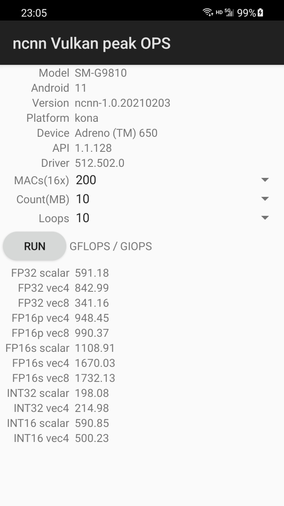

# ncnn-android-vkpeak

The ncnn android vulkan peak FLOPS app

## download apk

prebuild apk file can be download from release page

https://github.com/nihui/ncnn-android-vkpeak/releases

## how to build and run
### step1
clone this project with submodules

### step2
https://github.com/nihui/mesa-turnip-android-driver

* Download mesa-turnip-android-XYZ.zip
* Create directory **app/src/main/jniLibs/arm64-v8a** if not exists
* Extract `libvulkan_freedreno.so` from mesa-turnip-android-XYZ.zip into **app/src/main/jniLibs/arm64-v8a**

### step3
https://github.com/nihui/momoten/releases/tag/20261020

* Download the momoten Android runtime zip for each ABI (`arm64-v8a`, `armeabi-v7a`, `x86`, `x86_64`).
* Extract `lib/libmomoten.so` into **app/src/main/jniLibs/ABI** for the corresponding ABI.

momoten requires an accessible OpenCL driver on the device.

### step4
open this project with Android Studio, build it and enjoy!

## screenshot

